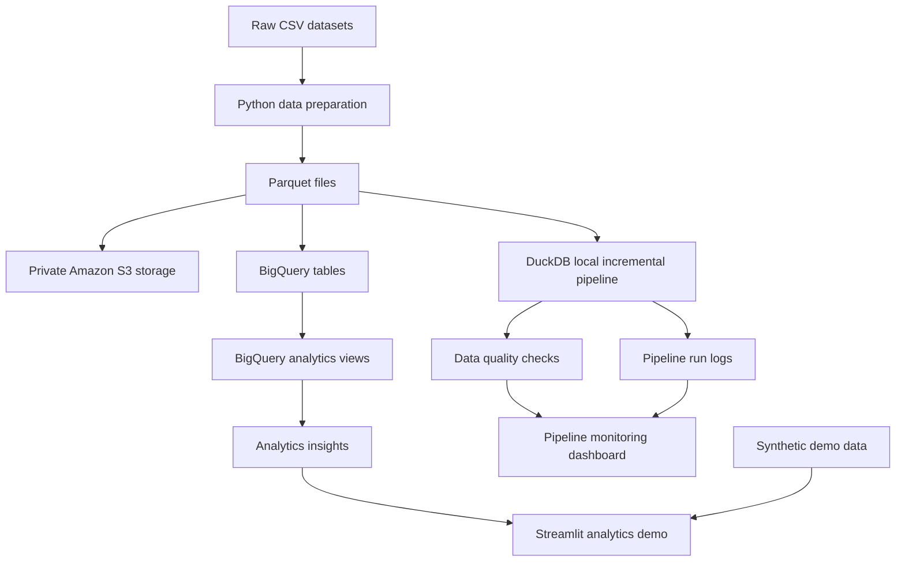

# Project Architecture

```text
Historical CSV files
        |
        v
Compressed Parquet
        |
        +----> Private AWS S3 storage
        |
        +----> BigQuery Sandbox
        |        |
        |        +----> SQL analytics views
        |
        v
DuckDB incremental processing prototype
        |
        +----> fact_orders
        +----> pipeline_runs
        +----> data_quality_results
                    |
                    v
             Streamlit dashboards
              /              \
     Pipeline monitoring   Business analytics
```

## Architecture Diagram

The following diagram shows the major components of the project. The diagram represents the overall architecture; the components are not all connected as one automated production pipeline.



## Current scope

- BigQuery is used for read-only SQL analytics.
- DuckDB is used for the local incremental upsert prototype.
- Dashboards currently run in Google Colab.
- Scheduling, production orchestration, and persistent dashboard hosting
  remain future improvements.
